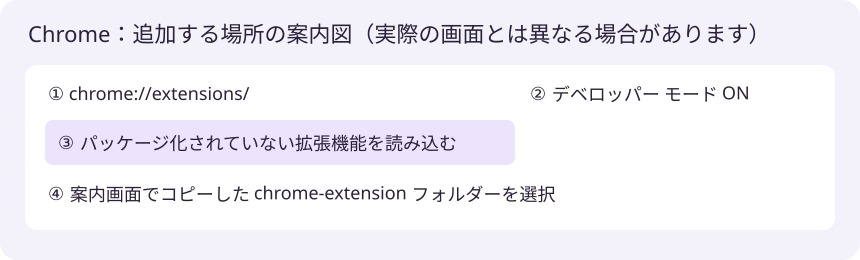
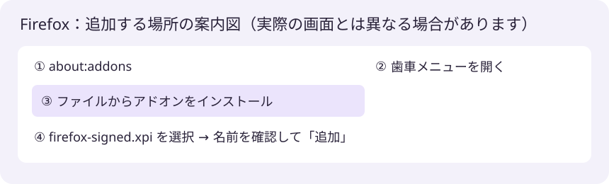

# 拡張機能を追加する：最後だけ本人が操作します

セットアップが表示する `finish.html` には、このPCで実際に選ぶ場所が表示されます。

## Chrome

1. Chromeのアドレス欄に `chrome://extensions/` と入力します。
2. **右上の「デベロッパー モード」**をONにします。
3. **「パッケージ化されていない拡張機能を読み込む」**を押します。
4. セットアップの案内にある「選ぶフォルダーをコピー」を押します。
5. フォルダー選択画面のアドレス欄へ貼り付け、そのフォルダーを選びます。
6. 一覧に「Irodori Voice Reader」が表示され、有効になれば追加完了です。

導入先の `chrome-extension` を選びます。配布ZIP、`scripts`、親フォルダーは選びません。
導入先は削除しないでください。元のダウンロード一式は導入先とは別です。

## Firefox

1. Firefoxのアドレス欄に `about:addons` と入力します。
2. アドオン画面の歯車メニューを開きます。
3. **「ファイルからアドオンをインストール」**を選びます。
4. セットアップが案内した `firefox-signed.xpi` を選びます。
5. 「Irodori Voice Reader」の名前と権限を確認して **「追加」**を押します。

署名無効化、一時的なアドオン読み込み、Firefox開発版への変更は不要です。

## 読み上げの確認

1. ツールバーの拡張ボタンからIrodori Voice Readerを開きます。
2. API接続済みとVoiceを確認します。
3. 自分が使うサイトと「音声を自動再生」をONにします。
4. 対象サイトを再読み込みし、新しい短い質問を送ります。

履歴を開くだけでは読み上げません。ChatGPT・Museは入力して送信した後の最新回答が対象です。
個人Voiceは同梱しないため、Voice未登録の場合は先にVoice管理でWAVを追加してください。

## 接続できないとき

setup.batの途中でヘルパー登録を断った場合は、再実行して確認します。
それでも接続しない場合はブラウザーを再起動し、READMEの対処表を確認してください。
